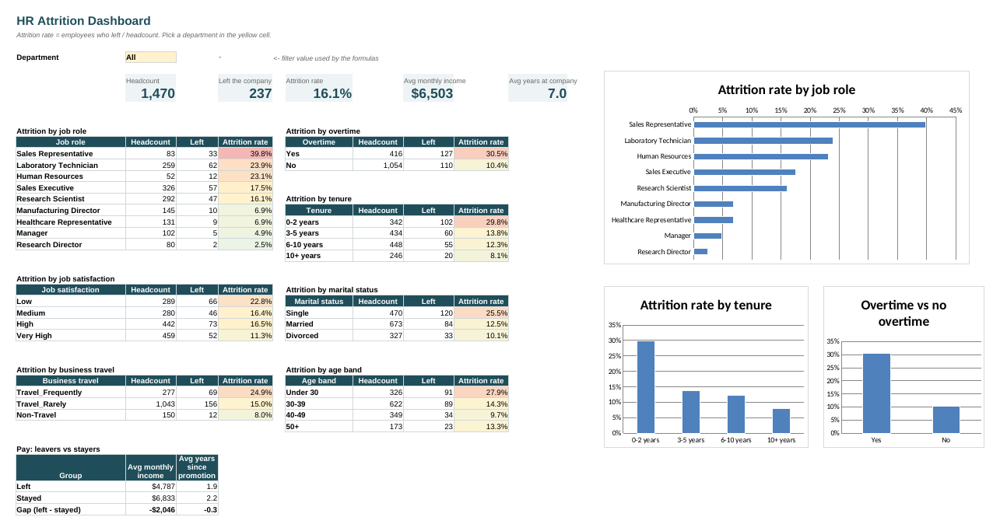

# HR Attrition & Workforce Report | Advanced Excel, SQL

An analysis of why employees leave. **SQL** (CTEs and window functions) answers the questions, and an interactive **Excel dashboard** lets HR filter every KPI by department.



---

## Business questions

1. What is the company's attrition rate, and which departments and roles lose the most people?
2. How do overtime, tenure, job level, pay and satisfaction relate to attrition?
3. Which employee segment is at highest risk, and what should HR do?

## Dataset

**IBM HR Analytics Employee Attrition** (sample data published by IBM): 1,470 employees and 35 columns. They cover demographics, department, role, job level, income, tenure, overtime, travel, satisfaction scores, and `Attrition` (Yes = left the company).

## Tools

| Tool | What I used |
|---|---|
| MySQL | Table design, lookup tables, data validation queries, `GROUP BY` aggregations, CTEs, window functions (`RANK`, `SUM() OVER`, `AVG() OVER PARTITION BY`), `CASE` banding, joins |
| Excel | Excel Table, `COUNTIFS`, `SUMIFS`, `AVERAGEIFS`, `INDEX`/`MATCH` lookups, data-validation dropdown filter, colour-scale conditional formatting, charts |

## Project structure

```
HR_Attrition_Workforce_Report/
├── data/
│   └── hr_employee_attrition.csv
├── sql/
│   ├── 01_create_tables.sql        employees table + rating and education lookup tables
│   ├── 02_load_and_validate.sql    load CSV, row and range checks, constant-column check
│   └── 03_analysis_queries.sql     10 analysis queries
├── excel/
│   └── HR_Attrition_Dashboard.xlsx
└── images/
    └── excel_dashboard.png
```

## How to run

**SQL** (MySQL 8+; also tested on MariaDB 10.11). Run from this folder:

```bash
mysql -u root -p < sql/01_create_tables.sql
mysql --local-infile=1 -u root -p < sql/02_load_and_validate.sql
mysql -u root -p < sql/03_analysis_queries.sql
```

If `LOAD DATA LOCAL INFILE` is refused, run `SET GLOBAL local_infile = 1;` once as admin.

**Excel:** open `excel/HR_Attrition_Dashboard.xlsx`, go to **Dashboard** and choose a department in the yellow cell. Every KPI, table and chart updates.

## Data validation

- 1,470 rows, 1,470 unique employee numbers, no missing values in reporting columns.
- Category values are clean (no typos or stray spaces).
- Range checks passed (for example, years at company never exceeds total working years).
- **Removed from analysis:** `EmployeeCount`, `Over18` and `StandardHours` hold a single value for everyone, so they carry no information.

## Key findings

| KPI | Value |
|---|---|
| Headcount | 1,470 |
| Employees who left | 237 |
| Attrition rate | **16.1%** |
| Avg monthly income | $6,503 |

1. **Sales has the highest attrition (20.6%).** R&D has the lowest rate (13.8%), but because it is the largest department it still accounts for 56% of all leavers.
2. **Sales Representatives leave at 39.8%**, the highest of any role, followed by Laboratory Technicians (23.9%) and HR staff (23.1%). Managers and Research Directors rarely leave (under 5%).
3. **Overtime triples the risk:** 30.5% attrition with overtime vs 10.4% without.
4. **The first two years are critical:** 29.8% attrition at 0–2 years, falling to 8.1% after 10 years.
5. **Entry-level and lower-paid staff leave most.** Job level 1 has 26.3% attrition. Leavers earn **$2,046 a month less** on average ($4,787 vs $6,833), and 61% of leavers are paid below the average for their department and level (vs 53% of stayers).
6. **Low satisfaction signals risk.** Low job satisfaction means 22.8% attrition (vs 11.3% at "very high"), low environment satisfaction 25.4%, and poor work-life balance 31.3%.
7. **Single employees (25.5%) and frequent travellers (24.9%)** leave far more than married staff (12.5%) and non-travellers (8.0%).
8. **Highest-risk segment:** entry-level (job level 1) employees with 2 years or less tenure who work overtime. There are 65 of them, and **61.5% left** (vs 14.0% for everyone else).

## Recommendations

1. **Review overtime policy**, starting with entry-level roles and Sales Representatives.
2. **Strengthen the first two years**: structured onboarding, a mentor, and 6- and 12-month career conversations.
3. **Benchmark entry-level and Sales Rep pay** against the market, and close below-peer pay gaps.
4. **Run stay interviews** where satisfaction or work-life balance scores are low.
5. **Track the high-risk segment monthly** using the dashboard's department filter.

## Practice extensions

These are worth doing so you can show them in interviews:
- **Pivot table:** insert one from the `Employees` table (Insert > PivotTable), with Rows = JobRole, Columns = OverTime, Values = Average of `Left` shown as %.
- **Power Query:** load the CSV through Data > From Text/CSV, remove the three constant columns and add the tenure band as a conditional column.
- **XLOOKUP:** in Excel 365, replace the `INDEX`/`MATCH` helper columns with `=XLOOKUP(M2,Lookups!$A$5:$A$8,Lookups!$B$5:$B$8)`.

## Skills demonstrated

SQL CTEs and window functions · lookup tables and joins · data validation · KPI design · interactive Excel dashboards · conditional formatting · translating data into HR actions

---
**Author:** Ashik Dev A S · [LinkedIn](https://www.linkedin.com/in/ashik-dev-301b63252)
